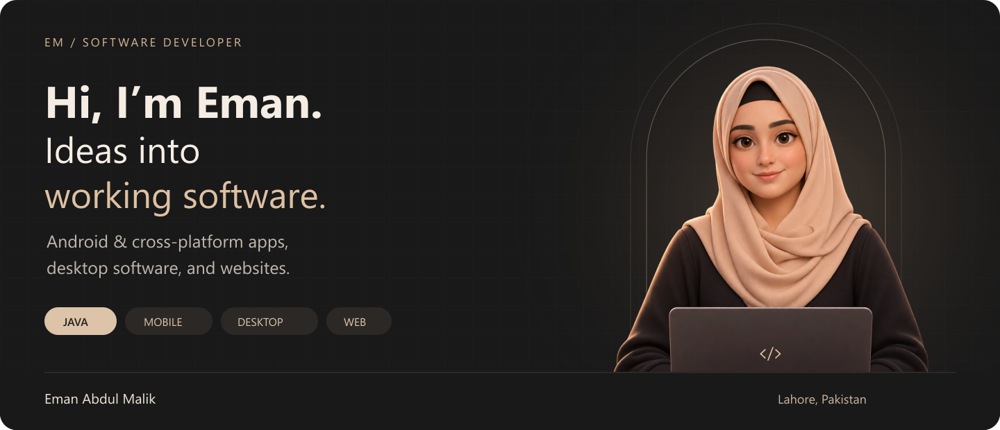
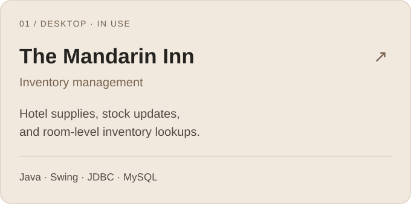
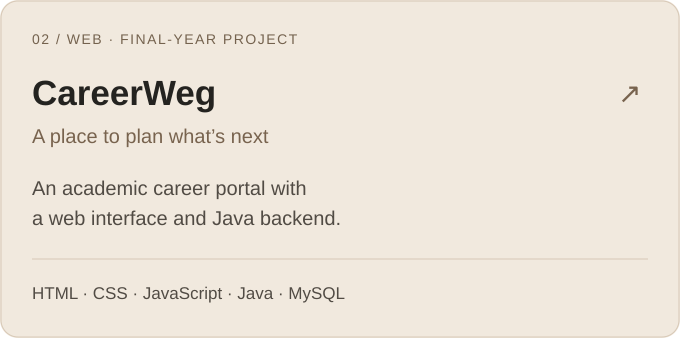
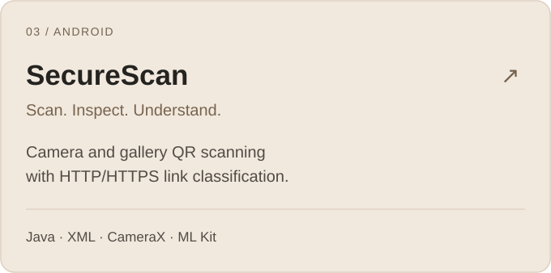
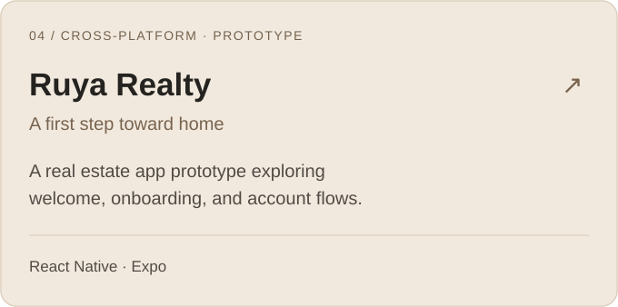

  
  
  
  

### A little about me

I’m **Eman**, a software engineering graduate from **Lahore Garrison University**, based in Lahore, Pakistan. I build mobile apps, desktop applications, and websites—and enjoy learning something new with every project.

My work includes inventory software for hotel operations, Android development, cross-platform app prototypes, and freelance websites. I like turning requirements into clear interfaces and useful software.

### Selected work

<table>
  <tr>
    <td width="50%"></td>
    <td width="50%"></td>
  </tr>
  <tr>
    <td></td>
    <td></td>
  </tr>
</table>

[Explore my repositories ↗](https://github.com/eman-110?tab=repositories) · [Visit my portfolio ↗](https://eman-portfolio-drab.vercel.app/)

### My toolkit

| Area | Technologies |
| :--- | :--- |
| **Java & desktop** | Java · Swing · JavaFX · JDBC · MySQL |
| **Mobile** | Android SDK · XML · React Native · Expo |
| **Web** | HTML · CSS · JavaScript · WordPress |
| **Data & APIs** | SQL · REST APIs · Firebase · Supabase · Spring Boot |
| **Tools** | Git · GitHub · IntelliJ IDEA · Android Studio · VS Code · Figma · Canva |

<strong>Experience & education</strong>

- **Freelance Software Developer** · May 2022–present
- **IT Intern, Defence Housing Authority** · October 2025–January 2026
- **Mobile App Developer, FH Group of Companies** · July–September 2025
- **Software Developer, The Mandarin Inn** · June–October 2024
- **Bachelor’s in Software Engineering** · Lahore Garrison University

### A year of building

### Let’s build something useful.

Have a mobile app, desktop application, website, or Java project in mind?

[Email me](mailto:emanabdulmalik18@gmail.com) · [Connect on LinkedIn](https://www.linkedin.com/in/eman-abdul-malik-90b042333) · [View my resume](https://drive.google.com/file/d/1JL720Y3wZwcoP-n_9x69w9R3gxcrWwNT/view?usp=sharing)

Building software. Always learning.
